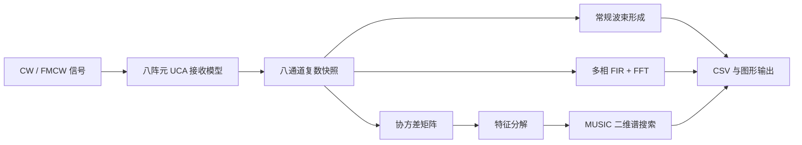

# 面向 RFSoC 的八通道波束形成与 DOA 估计算法验证

## 1. 项目简介

本工程建立了一套八通道阵列信号处理参考实现，用于验证均匀圆阵（UCA）接收、
波束形成、通道化和 MUSIC 测向的基本流程。工程包含通用 SystemVerilog 数据通路、
PS 端 C 接口、Python 算法模型、CSV 数据交换和结果显示。

当前版本完成了通用 RTL 与算法仿真，尚未接入 ANTSDR T510 实板。需要真实板卡
资料才能补充 RFDC、MTS、时钟、XDC、DMA 和天线校准。

## 2. 主要功能

- 八阵元均匀圆阵坐标和导向矢量计算；
- CW 与 FMCW 复基带信号生成；
- 指定方位角、俯仰角和信噪比的八通道数据合成；
- 常规相移波束形成及方位方向图计算；
- 多相 FIR + FFT 通道化演示；
- 基于协方差矩阵特征分解的二维 MUSIC 谱搜索；
- 八通道复数数据及 MUSIC 扫描结果的 CSV 导入、导出；
- Q1.15 复数乘法、八通道加权求和、查表 DDS 和复数 FIR RTL；
- PL/PS 数据接口、模拟采集后端和波束形成 Testbench；
- 命令行演示、简单参数界面和单元测试。

## 3. 工程结构

```text
48396全部代码/
├─ vivado/                 通用 PL 端 RTL、仿真与建工程 Tcl
│  ├─ rtl/                 DDS、复乘、FIR、八通道波束形成
│  ├─ sim/                 SystemVerilog Testbench
│  ├─ constraints/         T510 XDC 接入位置
│  ├─ bd/                  RFSoC Block Design 接入位置
│  └─ ip/                  RFDC、FFT、DMA 配置接入位置
├─ vitis/                  PS 端 C 接口与模拟平台后端
├─ host/                   CSV 采集数据分析入口
├─ rfsoc8_ref/              核心算法模块
│  ├─ geometry.py           UCA 几何与导向矢量
│  ├─ signals.py            CW/FMCW 和阵列数据生成
│  ├─ beamforming.py        常规波束形成
│  ├─ channelizer.py        多相 FIR + FFT 通道化
│  ├─ music.py              MUSIC 二维谱搜索
│  ├─ csvio.py              CSV 数据交换
│  ├─ visualization.py      结果绘图
│  └─ pipeline.py           完整处理流程
├─ examples/                参数配置示例
├─ tests/                   单元测试
├─ docs/                    架构及实板适配说明
├─ generated_demo/          默认参数运行结果
├─ run_demo.py              命令行入口
└─ run_ui.py                参数界面入口
```

## 4. 处理流程



八通道数据在程序中采用 `8 × N` 的复数矩阵表示，其中 N 为快照数。

PL 端参考数据通路采用 16 位 Q1.15 复数格式。`reference_array_pipeline.sv` 接收
八路同步 IQ 和八组复权值，输出一路复数波束数据。MUSIC 特征分解与谱搜索保留在
软件端，以便先建立正确性基线。

## 5. 环境与运行

建议使用 Python 3.10 或更高版本。

```powershell
python -m venv .venv
.venv\Scripts\Activate.ps1
python -m pip install -r requirements.txt
python run_demo.py --output generated_demo
```

运行单元测试：

```powershell
python -m unittest discover -s tests -v
```

启动参数界面：

```powershell
python run_ui.py
```

使用 JSON 配置运行：

```powershell
python run_demo.py --config examples/reference_config.json --output generated_demo
```

建立通用 Vivado RTL 工程：

```powershell
$env:FPGA_PART = "实际安装的器件型号"
vivado -mode batch -source vivado/build_reference_project.tcl
```

该 Tcl 只建立通用 RTL 工程，不会自动生成 T510 RFDC Block Design。

## 6. 默认参数与结果

默认配置采用 2.4 GHz 载频、1 MHz 基带采样率、半径 0.04 m 的八阵元圆阵，
合成信号方向为方位角 35°、俯仰角 15°，信噪比为 15 dB。

默认运行结果：

| 项目 | 数值 |
|---|---:|
| 合成方位角 | 35° |
| MUSIC 方位角估计 | 34° |
| 合成俯仰角 | 15° |
| MUSIC 俯仰角估计 | 14° |

估计误差主要来自 2° 的搜索网格间隔和所加入的随机噪声。结果保存在
`generated_demo/summary.json` 中。

## 7. 输出文件

| 文件 | 内容 |
|---|---|
| `synthetic_snapshots.csv` | 八通道复数 IQ 快照 |
| `music_spectrum.csv` | 方位角、俯仰角及 MUSIC 谱值 |
| `array_geometry.png` | 阵元分布 |
| `beam_pattern.png` | 波束方向图 |
| `channelizer.png` | 通道化频谱 |
| `music_spectrum.png` | 二维 MUSIC 空间谱 |
| `summary.json` | 参数和估计结果汇总 |

CSV 每行对应一个同步采样点：

```text
sample,ch0_real,ch0_imag,ch1_real,ch1_imag,...,ch7_real,ch7_imag
```

其中 IQ 数据为归一化浮点数。接入硬件后需要根据实际 ADC 数据格式增加定点转换、
缩放、通道映射、帧同步和时间戳处理。

## 8. 角度约定

方位角在 XY 平面内由 +X 轴指向 +Y 轴，俯仰角由 XY 平面指向 +Z 轴。八个阵元
均位于 XY 平面，因此平面圆阵对正负俯仰角存在对称性，高俯仰角下的估计条件也会
变差。本程序将俯仰角搜索范围限制为 0°～60°。

## 9. 当前限制

- 采用远场、窄带、理想全向阵元模型；
- 未加入阵元互耦、通道幅相误差、时钟抖动、量化和温漂；
- FMCW 部分用于生成线性调频测试信号，未实现完整测距、测速处理；
- 通道化和 MUSIC 均为浮点软件实现，未进行 FPGA 定点化和资源评估；
- 角度结果为合成数据验证结果，不代表实际天线阵列测量精度。

实板适配项目见 `docs/HARDWARE_TODO.md`。

